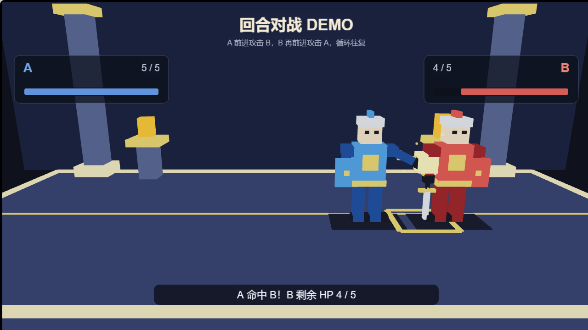

# three-king · 4v4 回合对战 DEMO

一个用 **Cocos Creator 3.8.8** 做的极简回合制对战演示。场景里没有预制的美术资源，
角色、场地和 UI 全部在运行时由代码用方块拼出来，所以拉下项目打开就能跑。

## 玩法

- 左右各一支队伍，**每队 4 人**，横排（沿纵深方向）列阵，蓝方在右、红方在左。
- 每回合按 **A1 → B1 → A2 → B2 → A3 → B3 → A4 → B4** 的顺序轮流行动。
- 每个人行动前都要先**选择攻击目标**：
  - 存活敌人脚下浮现蓝色候选光环；
  - 短暂停顿后锁定其中一人，目标光环变金色、头顶出现旋转的锁定框，HUD 也会高亮；
  - 随后冲向目标挥剑，造成 1 点伤害，再退回原位。
- 阵亡的角色会倒地并留在场上，直到本场结束。
- 任意一队 4 人全部倒下时弹出胜负提示，2.6 秒后全员满血复位，开始下一场。

每人 5 点生命值，每命中一次扣 1 点。当前回合、行动者、选中的目标和命中结果都会显示在
画面上的战斗日志里。

当前的目标选择是**自动 AI**：优先打残血（尽快让对手减员），血量相同时挑最近的敌人。
如果想改成玩家点击选择，或者在回合开始前先把 8 个人的目标一次性选完再统一结算，
改 `DuelGame.ts` 里的 `chooseTarget()` / `runBattle()` 即可。

> 下面的截图来自 1v1 旧版，4v4 版本的画面布局（8 块 HUD、两队列阵）已经变化。



## 项目结构

```
assets/
  scenes/Duel.scene        场景（只放相机、灯光和启动器组件）
  scripts/DuelGame.ts      游戏主体：场地、8 名角色、UI、目标选择、战斗流程、命中特效
  scripts/DuelLauncher.ts  启动器：保证场景加载后 DuelGame 一定存在
settings/                  项目设置
profiles/                  编辑器设置（预览起始场景已指向 Duel.scene）
```

`DuelGame` 在 `onLoad` 里先确保 `builtin-standard`（PBR）效果可用，再搭建
世界、相机、灯光、场地、8 个角色和 Canvas UI，最后启动一条用 `await` 串起来的
回合流程。移动、挥剑、受击后退和胜负结算都用 `tween` 完成，命中判定在挥剑到位
后按两人距离检查。

常用可调参数都在文件顶部：`TEAM_SIZE`（每队人数）、`MAX_HP`（每人血量）、
`FORMATION_Z`（每队 4 人的纵深站位）、`HOME_X`（两队的 x 坐标）。

## 运行方式

1. 用 Cocos Creator 3.8.8 打开本文件夹（`Duel.scene` 已设为预览起始场景）。
2. 点编辑器上方的 **预览** 按钮，或打开 `Duel.scene` 后预览。

需要命令行构建时（Windows）：

```bash
CocosCreator.exe --project D:\code\cocos_creator_demo\people-battle --build "platform=web-desktop;debug=true"
```

构建产物在 `build/web-desktop`，用本地静态服务器打开 `index.html` 即可。

## 开发

编辑器里保存脚本后会自动编译。想在不启动编辑器的情况下检查类型，可以用仓库里的
`tsconfig.check.json`（依赖编辑器生成的 `temp/declarations/cc.d.ts`）：

```bash
tsc -p tsconfig.check.json
```

## 备注

- 角色、场地和 UI 都是代码生成的，`Duel.scene` 只保留相机、灯光和启动器，方便对照调整。
- `DuelLauncher` 通过 `director.on(Director.EVENT_AFTER_SCENE_LAUNCH)` 挂载游戏，
  所以场景里不用手动拖组件，换成任意带相机的场景也能跑起来。
